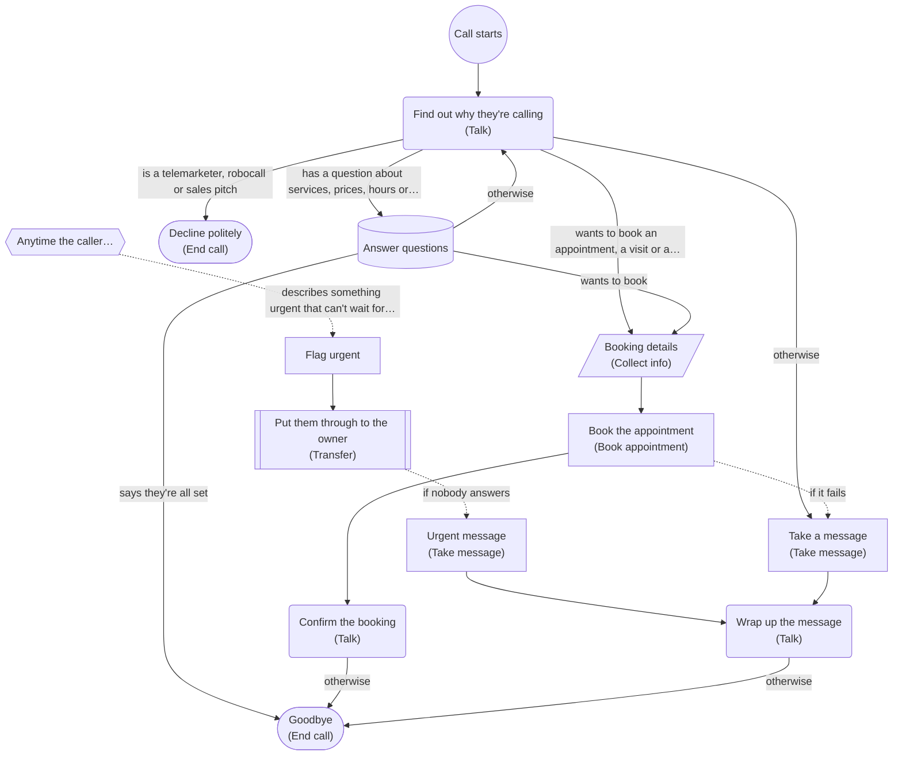

# Agency starter

A starting point for agencies that set up agents for many clients. It covers what nearly every local business needs and nothing client-specific, so you can import it into each client workspace and change the wording.

## What it handles

- Questions, from the client's knowledge base.
- Bookings: what they need and an address when the work is on site.
- Urgent calls from anywhere in the call: flagged, put through to the owner, an urgent message if nobody answers.
- Messages for everything else, and a polite no to telemarketers.
- `how_heard` is picked up whenever a caller mentions it, for your client reports.

## Steps

<!-- BEGIN GENERATED: diagram (npm run diagram) -->
<!-- prettier-ignore-start -->

| Field | Type | Asked | What it's for |
| --- | --- | --- | --- |
| `service_needed` | string | Required | What they want done, in their words. |
| `service_address` | string | Optional | Street address, if the work happens on site. |
| `how_heard` | string | Picked up, never asked | Marketing source, if mentioned. Useful for reporting to the client. |

<!-- prettier-ignore-end -->
<!-- END GENERATED: diagram -->

## Before you publish

Business settings to add under **Whole call → Business settings**:

| Setting        | What to set                                          |
| -------------- | ---------------------------------------------------- |
| `owner_number` | The client's owner or manager cell for urgent calls. |

- Import into each client workspace from your agency account. See [Client workspaces](https://tryladoo.com/docs/agencies/client-workspaces).
- Turn on **Book appointments** and **Look up open times** under **Tools** on the **Agent** tab, and connect a calendar.
- Change the urgent branch under **Whole call → Anytime the caller…** to what counts as urgent for the client.
- Make a test call for each path. See [Test your agent](https://tryladoo.com/docs/getting-started/test-your-agent).

## Import

Download [`workflow.lassi-workflow.json`](workflow.lassi-workflow.json), then in Ladoo open the agent's **Workflow** tab and choose **⋯ → Import from file**. To import through the API, see [Import into Ladoo](../../../README.md#import-into-ladoo).
