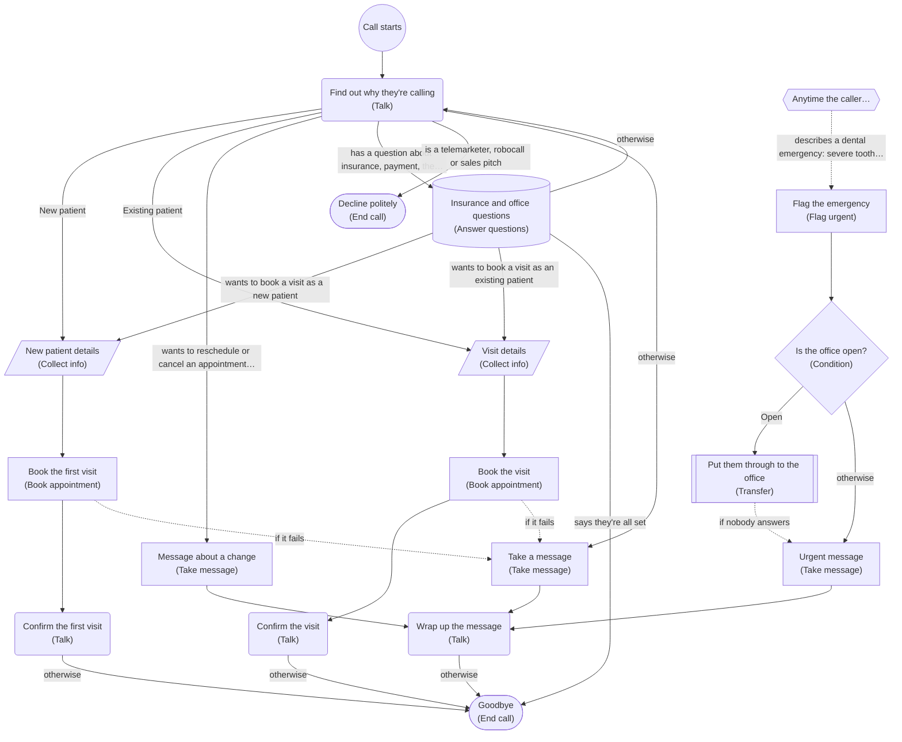

# Dental new-patient booking

Books first visits for new patients, including parents booking for children, and visits for existing patients. Insurance and office questions come from the knowledge base. Dental emergencies go to the office during booking hours and to an urgent message after.

## What it handles

- New patients: patient name, reason for the visit and insurance, then a booking and a reminder to arrive early with their insurance card.
- Existing patients booking a visit. Changes and cancellations become a message for the front desk.
- Insurance, payment and "what happens at a first visit" questions, without guessing coverage.
- Emergencies (severe pain, swelling, a broken or knocked-out tooth) from anywhere in the call: flagged urgent, ER advice for red-flag symptoms, then the office or an urgent message.

## Steps

<!-- BEGIN GENERATED: diagram (npm run diagram) -->
<!-- prettier-ignore-start -->

| Field | Type | Asked | What it's for |
| --- | --- | --- | --- |
| `patient_name` | string | Required | Full name of the person the visit is for, which may not be the caller. |
| `visit_reason` | one of `cleaning_and_exam`, `tooth_pain`, `cosmetic_consult`, `second_opinion`, `other` | Required | What the visit is for. |
| `insurance_provider` | string | Optional | Name of the patient's dental insurance, or none. |
| `how_heard` | string | Picked up, never asked | Referral or marketing source, if mentioned. |

<!-- prettier-ignore-end -->
<!-- END GENERATED: diagram -->

## Before you publish

Business settings to add under **Whole call → Business settings**:

| Setting         | What to set                                             |
| --------------- | ------------------------------------------------------- |
| `office_number` | The front desk line that takes transferred emergencies. |

- Turn on **Book appointments** and **Look up open times** under **Tools** on the **Agent** tab, and connect a calendar.
- Set your booking hours in **Calendar → Settings**. The Condition step reads them on every call.
- Add a knowledge base with the insurance plans you accept, payment options, parking and what a first visit involves.
- Make a test call for each path. See [Test your agent](https://tryladoo.com/docs/getting-started/test-your-agent).

## Import

Download [`workflow.lassi-workflow.json`](workflow.lassi-workflow.json), then in Ladoo open the agent's **Workflow** tab and choose **⋯ → Import from file**. To import through the API, see [Import into Ladoo](../../../README.md#import-into-ladoo).
