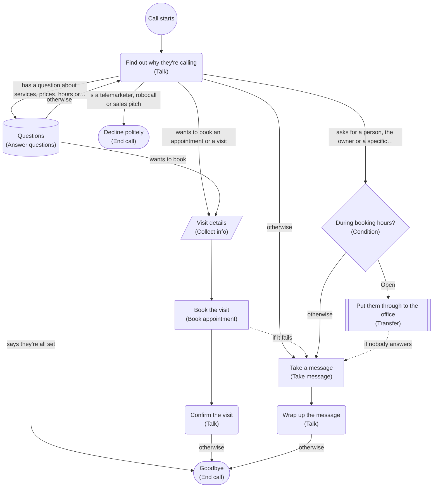

# Bilingual front desk (English and Spanish)

A general front desk for businesses with English and Spanish callers. The workflow stays in English; Ladoo answers Spanish speakers in Spanish from the same steps, and the prompts ask it to keep read-backs in the caller's language.

## What it handles

- Questions, from the knowledge base.
- Bookings: what the visit is for, then two open times.
- Requests for a person: put through to the office during booking hours, a message otherwise or when nobody answers.
- Messages, with the caller's preferred language noted for the callback.

## Steps

<!-- BEGIN GENERATED: diagram (npm run diagram) -->
<!-- prettier-ignore-start -->

| Field | Type | Asked | What it's for |
| --- | --- | --- | --- |
| `visit_reason` | string | Required | What the visit is for, in the caller's words. |
| `how_heard` | string | Picked up, never asked | Referral or marketing source, if mentioned. |

<!-- prettier-ignore-end -->
<!-- END GENERATED: diagram -->

## Before you publish

Business settings to add under **Whole call → Business settings**:

| Setting         | What to set                                   |
| --------------- | --------------------------------------------- |
| `office_number` | The office line that takes transferred calls. |

- Under **Basics → Languages** on the **Agent** tab, choose **English and Spanish**. See [Spanish-speaking callers](https://tryladoo.com/docs/agents/spanish-callers).
- Turn on **Book appointments** and **Look up open times** under **Tools** on the **Agent** tab, and connect a calendar.
- Set your booking hours in **Calendar → Settings**. The Condition step reads them on every call.
- Make a test call for each path. See [Test your agent](https://tryladoo.com/docs/getting-started/test-your-agent).

## Import

Download [`workflow.lassi-workflow.json`](workflow.lassi-workflow.json), then in Ladoo open the agent's **Workflow** tab and choose **⋯ → Import from file**. To import through the API, see [Import into Ladoo](../../../README.md#import-into-ladoo).
