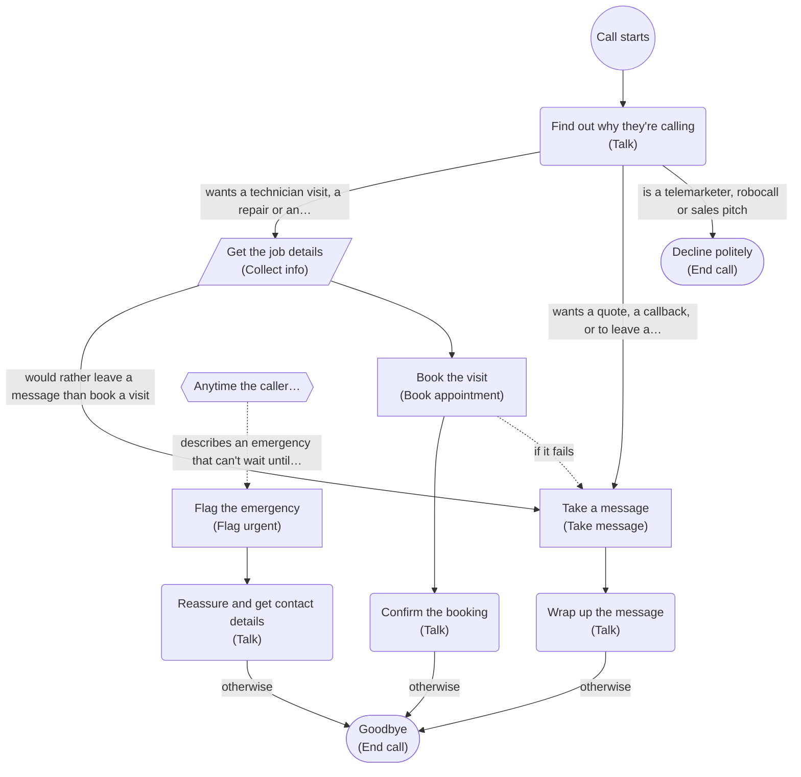

# After-hours receptionist

Covers the phones while the office is closed. Callers can book a visit, leave a message, or get flagged as an emergency. This is the same **After-hours receptionist** template you can start from in Ladoo.

## What it handles

- Visit requests: service address and equipment, then two open times and a booking. If booking fails, a message.
- Quotes and callbacks: a message for the morning.
- Emergencies from anywhere in the call: flagged urgent, one safety tip, and a callback promise without an arrival time.
- Telemarketers, turned away without business details.

## Steps

<!-- BEGIN GENERATED: diagram (npm run diagram) -->
<!-- prettier-ignore-start -->

| Field | Type | Asked | What it's for |
| --- | --- | --- | --- |
| `service_address` | string | Required | Street address where the work is needed. |
| `equipment_type` | one of `furnace`, `boiler`, `water_heater`, `ac`, `plumbing_fixture`, `pipes`, `other` | Optional | What needs service. |
| `is_homeowner` | boolean | Optional | Whether the caller owns the home. |
| `how_heard` | string | Picked up, never asked | Marketing source, if mentioned. |

<!-- prettier-ignore-end -->
<!-- END GENERATED: diagram -->

## Before you publish

- Turn on **Book appointments** and **Look up open times** under **Tools** on the **Agent** tab, and connect a calendar.
- Point your after-hours call forwarding at the agent's number, or use it as the only line overnight.
- Make a test call for each path. See [Test your agent](https://tryladoo.com/docs/getting-started/test-your-agent).

## Import

Download [`workflow.lassi-workflow.json`](workflow.lassi-workflow.json), then in Ladoo open the agent's **Workflow** tab and choose **⋯ → Import from file**. To import through the API, see [Import into Ladoo](../../../README.md#import-into-ladoo).
