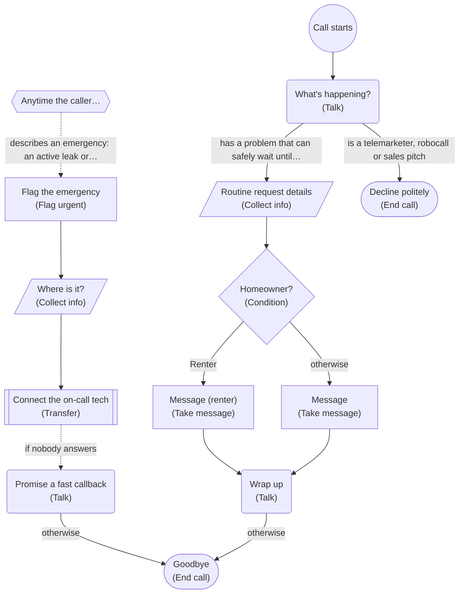

# Emergency triage

Separates emergencies from routine requests for plumbing and HVAC companies. This is the same **Emergency triage** template you can start from in Ladoo.

## What it handles

- Burst pipes, flooding, gas smells, no heat in freezing weather and other emergencies, from anywhere in the call: flagged urgent, address taken, and put through to the on-call tech.
- A callback promise with one safety tip when the on-call tech doesn't answer.
- Routine requests: service address, equipment and whether they own the home, then a message. Renters are reminded to tell their landlord.
- Telemarketers, turned away without business details.

## Steps

<!-- BEGIN GENERATED: diagram (npm run diagram) -->
<!-- prettier-ignore-start -->

| Field | Type | Asked | What it's for |
| --- | --- | --- | --- |
| `service_address` | string | Required | Street address where the work is needed. |
| `equipment_type` | one of `furnace`, `boiler`, `water_heater`, `ac`, `plumbing_fixture`, `pipes`, `other` | Optional | What needs service. |
| `is_homeowner` | boolean | Optional | Whether the caller owns the home. |

<!-- prettier-ignore-end -->
<!-- END GENERATED: diagram -->

## Before you publish

Business settings to add under **Whole call → Business settings**:

| Setting         | What to set                                                                       |
| --------------- | --------------------------------------------------------------------------------- |
| `oncall_number` | The on-call technician's cell, like `+15125550187`. US and Canadian numbers only. |

- Put your service area, hours and prices in a knowledge base so the agent can answer questions along the way.
- Make a test call for each path. See [Test your agent](https://tryladoo.com/docs/getting-started/test-your-agent).

## Import

Download [`workflow.lassi-workflow.json`](workflow.lassi-workflow.json), then in Ladoo open the agent's **Workflow** tab and choose **⋯ → Import from file**. To import through the API, see [Import into Ladoo](../../../README.md#import-into-ladoo).
