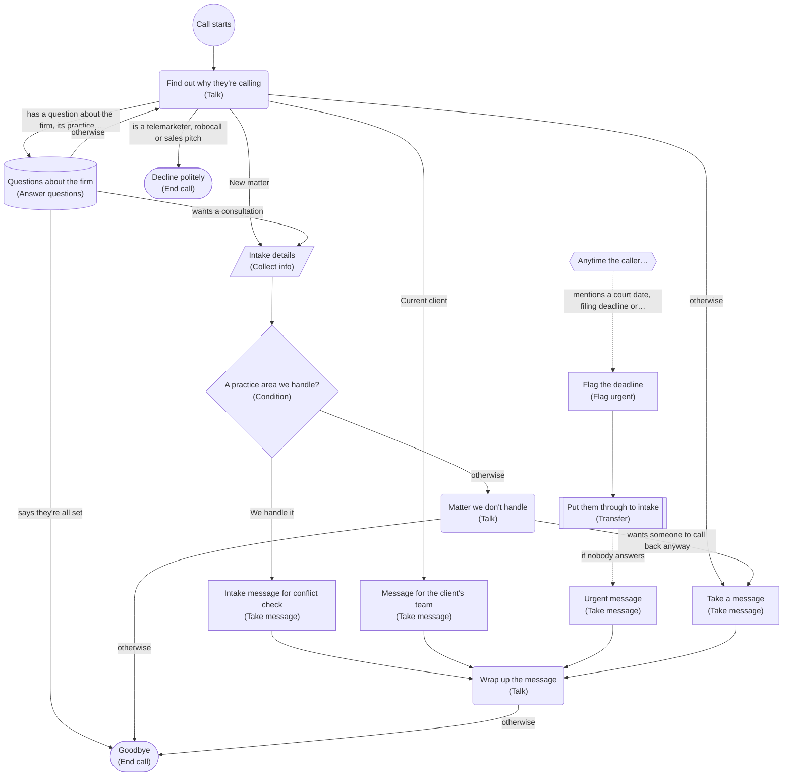

# Law firm intake with conflict check

Screens new matters for a firm that handles personal injury, family, estate planning and employment law. It gets the other party's name up front so intake can run a conflict check before anyone discusses the case, and it never gives legal advice.

## What it handles

- New matters: client name, practice area, the other party, a one or two sentence summary and any deadline, then an intake message marked for a conflict check.
- Matters the firm doesn't handle: a pointer to the state bar's referral service.
- Current clients, as a message for their attorney, without discussing the case.
- Court dates, filing deadlines, arrests and service of papers, from anywhere in the call: flagged urgent and put through to intake.

## Steps

<!-- BEGIN GENERATED: diagram (npm run diagram) -->
<!-- prettier-ignore-start -->

| Field | Type | Asked | What it's for |
| --- | --- | --- | --- |
| `client_name` | string | Required | Full name of the person who needs help, which may not be the caller. |
| `practice_area` | one of `personal_injury`, `family`, `estate_planning`, `employment`, `criminal`, `real_estate`, `other` | Required | The kind of legal matter. |
| `opposing_party` | string | Required | Full name of the other person or company involved, for the conflict check. "None" if there isn't one. |
| `matter_summary` | string | Required | A sentence or two about what happened. No confidential details. |
| `upcoming_deadline` | date | Optional | A court date or filing deadline, if there is one. |
| `how_heard` | string | Picked up, never asked | Referral or marketing source, if mentioned. |

<!-- prettier-ignore-end -->
<!-- END GENERATED: diagram -->

## Before you publish

Business settings to add under **Whole call → Business settings**:

| Setting         | What to set                                       |
| --------------- | ------------------------------------------------- |
| `intake_number` | The intake coordinator's line for urgent matters. |

- Change the practice areas in the **A practice area we handle?** step and the `practice_area` options to match your firm.
- Add a knowledge base with your practice areas, consultation fees, office hours and location.
- Have your intake team review the disclaimer wording in **Intake message for conflict check** against your state's rules.
- Make a test call for each path. See [Test your agent](https://tryladoo.com/docs/getting-started/test-your-agent).

## Import

Download [`workflow.lassi-workflow.json`](workflow.lassi-workflow.json), then in Ladoo open the agent's **Workflow** tab and choose **⋯ → Import from file**. To import through the API, see [Import into Ladoo](../../../README.md#import-into-ladoo).
