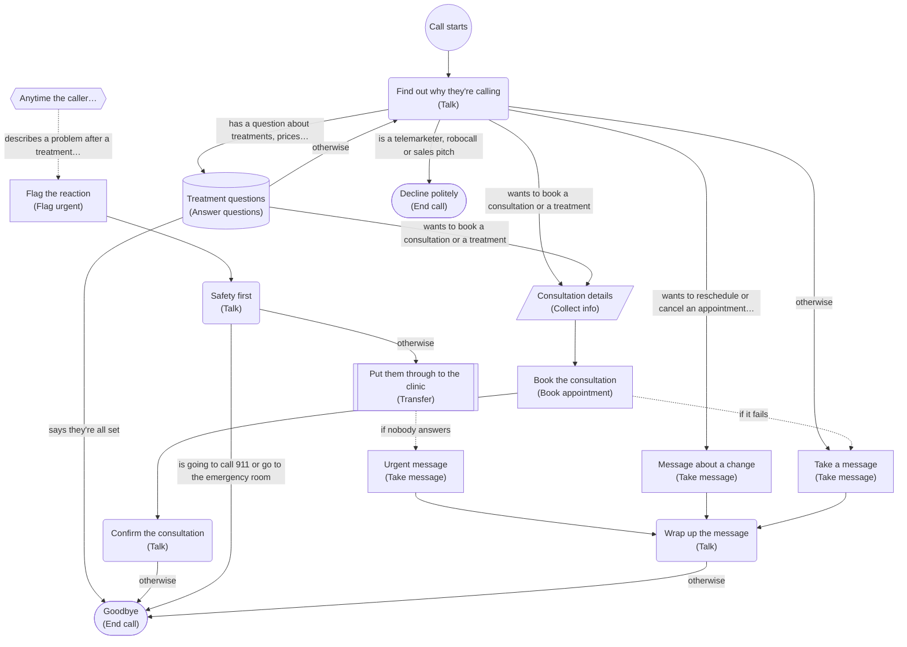

# Med spa consultations

Books consultations for injectables, lasers, facials and other treatments, and answers price and prep questions from the knowledge base without giving medical advice. Callers describing a reaction after a treatment get safety advice first and then a provider.

## What it handles

- Consultations: treatment, first visit or not, and a preferred provider, then a booking.
- Prices, specials, downtime and prep, from the knowledge base only.
- Reactions after a treatment, from anywhere in the call: flagged urgent, 911 for red-flag symptoms, otherwise put through to the clinic or an urgent message.
- Changes to existing appointments, as a message for the front desk.

## Steps

<!-- BEGIN GENERATED: diagram (npm run diagram) -->
<!-- prettier-ignore-start -->

| Field | Type | Asked | What it's for |
| --- | --- | --- | --- |
| `treatment_interest` | one of `injectables`, `dermal_fillers`, `laser_hair_removal`, `facial`, `chemical_peel`, `body_contouring`, `not_sure` | Required | The treatment they're interested in. |
| `first_visit` | boolean | Required | Whether this is their first visit to the clinic. |
| `preferred_provider` | string | Optional | A provider they asked for by name, if any. |
| `how_heard` | string | Picked up, never asked | Referral or marketing source, if mentioned. |

<!-- prettier-ignore-end -->
<!-- END GENERATED: diagram -->

## Before you publish

Business settings to add under **Whole call → Business settings**:

| Setting         | What to set                                                       |
| --------------- | ----------------------------------------------------------------- |
| `clinic_number` | The line a provider or nurse answers for post-treatment concerns. |

- Turn on **Book appointments** and **Look up open times** under **Tools** on the **Agent** tab, and connect a calendar.
- Add a knowledge base with treatments, starting prices, specials, downtime, prep instructions and your cancellation policy.
- Make a test call for each path. See [Test your agent](https://tryladoo.com/docs/getting-started/test-your-agent).

## Import

Download [`workflow.lassi-workflow.json`](workflow.lassi-workflow.json), then in Ladoo open the agent's **Workflow** tab and choose **⋯ → Import from file**. To import through the API, see [Import into Ladoo](../../../README.md#import-into-ladoo).
