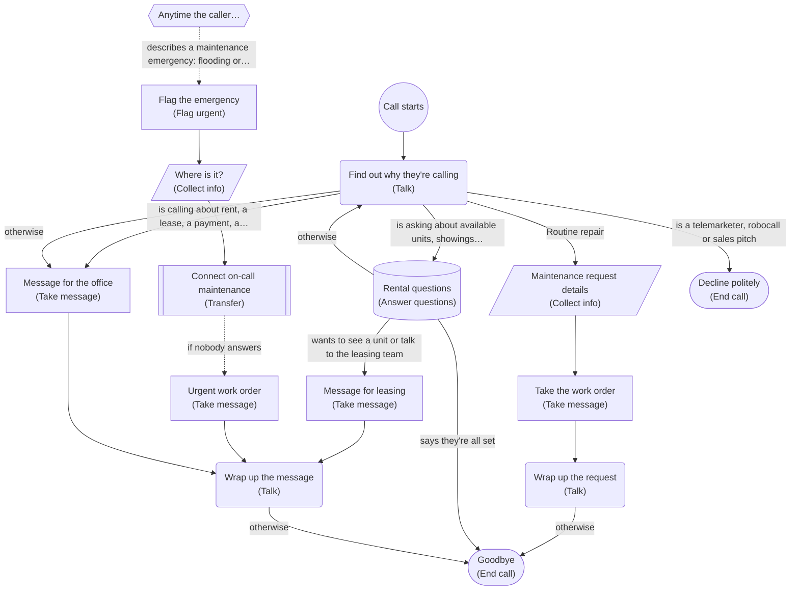

# Property maintenance requests

Takes maintenance requests from tenants as complete work orders, puts emergencies through to on-call maintenance, and answers rental questions from the knowledge base.

## What it handles

- Routine repairs: address, unit, issue type, a description, permission to enter and pets, saved as a work order message.
- Emergencies (flooding, no heat, gas, sparking, sewage, a door that won't lock) from anywhere in the call: flagged urgent, safety advice, address and unit, then on-call maintenance.
- Prospective renters: availability, pets, fees and how to apply, then a message for leasing.
- Rent, lease and billing calls, as a message for the office without discussing balances.

## Steps

<!-- BEGIN GENERATED: diagram (npm run diagram) -->
<!-- prettier-ignore-start -->

| Field | Type | Asked | What it's for |
| --- | --- | --- | --- |
| `property_address` | string | Required | Street address of the building. |
| `unit_number` | string | Required | Unit or apartment number. "None" for a single-family home. |
| `issue_category` | one of `plumbing`, `electrical`, `appliance`, `heating_cooling`, `doors_locks`, `pests`, `other` | Required | What kind of problem it is. |
| `issue_description` | string | Required | The problem in the caller's words. |
| `permission_to_enter` | boolean | Required | Whether maintenance may enter if the tenant isn't home. |
| `pets_in_unit` | boolean | Optional | Whether there are pets in the unit that maintenance should know about. |

<!-- prettier-ignore-end -->
<!-- END GENERATED: diagram -->

## Before you publish

Business settings to add under **Whole call → Business settings**:

| Setting                     | What to set                    |
| --------------------------- | ------------------------------ |
| `maintenance_oncall_number` | The on-call maintenance phone. |

- Add a knowledge base with available units, rent ranges, pet policy, application steps and fees.
- Make a test call for each path. See [Test your agent](https://tryladoo.com/docs/getting-started/test-your-agent).

## Import

Download [`workflow.lassi-workflow.json`](workflow.lassi-workflow.json), then in Ladoo open the agent's **Workflow** tab and choose **⋯ → Import from file**. To import through the API, see [Import into Ladoo](../../../README.md#import-into-ladoo).
