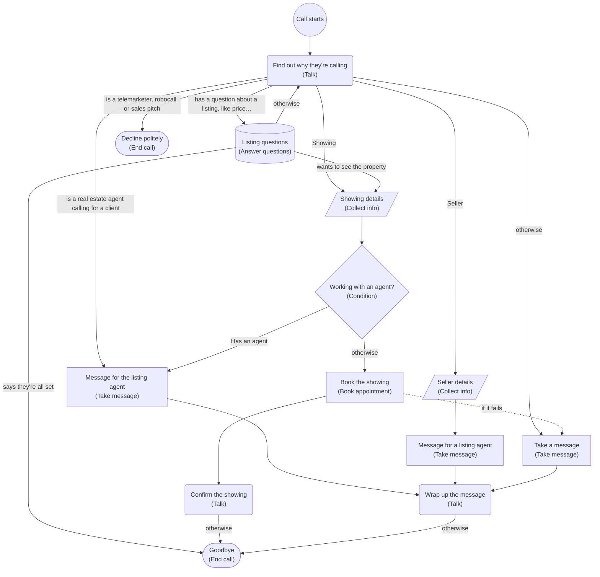

# Real estate showing requests

Handles calls from listing signs and websites: answers listing questions from the knowledge base, books showings for unrepresented buyers, and sends buyers' agents and sellers to the right person.

## What it handles

- Showings: listing address, whether they have an agent and financing, then a booking. Buyers with an agent become an agent-to-agent message.
- Listing questions (price, size, HOA, open houses) from the knowledge base, with fair-housing-safe answers about neighborhoods and schools.
- Sellers: property address and timeline, then a message for a listing agent. No valuations on the phone.
- Calls from other agents, as a message for the listing agent.

## Steps

<!-- BEGIN GENERATED: diagram (npm run diagram) -->
<!-- prettier-ignore-start -->

| Field | Type | Asked | What it's for |
| --- | --- | --- | --- |
| `listing_address` | string | Required | Address or MLS number of the listing they want to see. |
| `has_agent` | boolean | Required | Whether the caller is already working with a real estate agent. |
| `financing_status` | one of `pre_approved`, `cash`, `not_yet` | Optional | Where they are with financing, if they want to say. |
| `property_address` | string | Required | Address of the home they want to sell. |
| `sell_timeline` | one of `now`, `within_3_months`, `within_a_year`, `just_curious` | Required | When they hope to sell. |
| `how_heard` | string | Picked up, never asked | Sign, website, referral or other source, if mentioned. |

<!-- prettier-ignore-end -->
<!-- END GENERATED: diagram -->

## Before you publish

- Turn on **Book appointments** and **Look up open times** under **Tools** on the **Agent** tab, and connect a calendar.
- Keep a knowledge base of your active listings, with status, price, features, HOA fees and open house times. Update it when a listing goes under contract.
- Make a test call for each path. See [Test your agent](https://tryladoo.com/docs/getting-started/test-your-agent).

## Import

Download [`workflow.lassi-workflow.json`](workflow.lassi-workflow.json), then in Ladoo open the agent's **Workflow** tab and choose **⋯ → Import from file**. To import through the API, see [Import into Ladoo](../../../README.md#import-into-ladoo).
