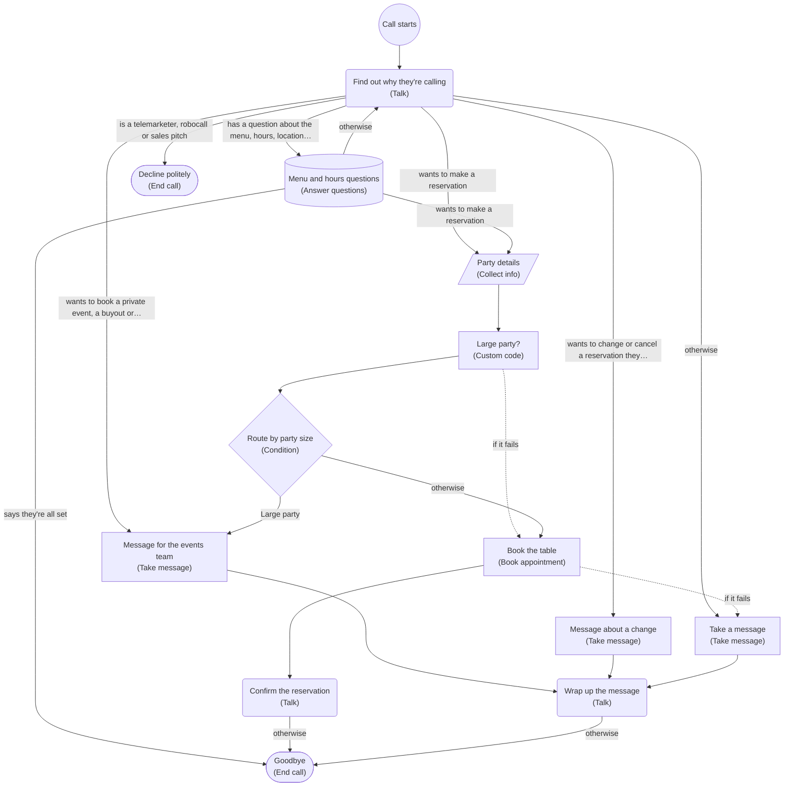

# Restaurant reservations and FAQ

Answers the questions restaurants get all day (hours, menu, parking, allergens, takeout) and books tables. Parties above your limit and private events go to the events team as a message.

## What it handles

- Reservations: party size and special requests, then a booking.
- Large parties: a Custom code step compares the party size with `max_party_size` and sends bigger groups to the events team.
- Menu, hours, location, parking, dietary and takeout questions, from the knowledge base, with a careful answer for serious allergies.
- Changes to existing reservations, as a message.

## Steps

<!-- BEGIN GENERATED: diagram (npm run diagram) -->
<!-- prettier-ignore-start -->

| Field | Type | Asked | What it's for |
| --- | --- | --- | --- |
| `party_size` | number | Required | How many people, including children. |
| `special_requests` | string | Optional | Accessibility needs, high chairs, allergies or a celebration. |

<!-- prettier-ignore-end -->
<!-- END GENERATED: diagram -->

## Before you publish

Business settings to add under **Whole call → Business settings**:

| Setting          | What to set                                                                                                        |
| ---------------- | ------------------------------------------------------------------------------------------------------------------ |
| `max_party_size` | The largest party you book online, like `8`. Bigger groups go to the events team. Defaults to 8 when it isn't set. |

- Turn on **Book appointments** and **Look up open times** under **Tools** on the **Agent** tab, and connect a calendar. Use table slots as the calendar's open times.
- Add a knowledge base with your menu, hours, location, parking, allergen notes and online ordering link.
- Make a test call for each path. See [Test your agent](https://tryladoo.com/docs/getting-started/test-your-agent).

## Import

Download [`workflow.lassi-workflow.json`](workflow.lassi-workflow.json), then in Ladoo open the agent's **Workflow** tab and choose **⋯ → Import from file**. To import through the API, see [Import into Ladoo](../../../README.md#import-into-ladoo).
