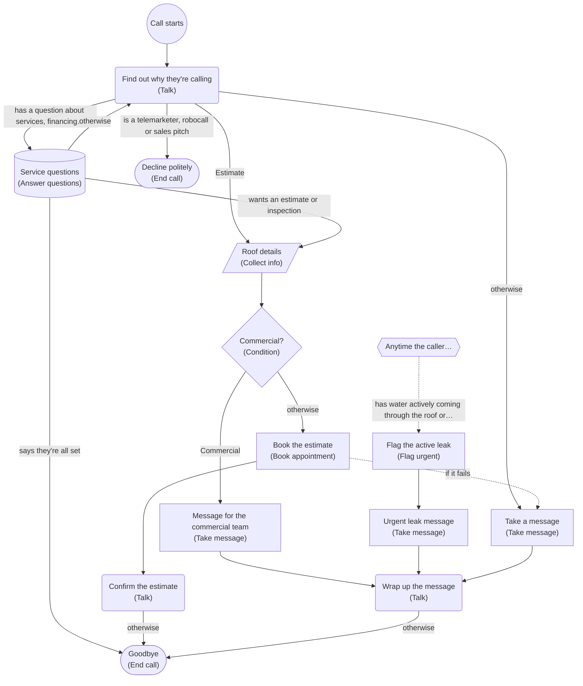

# Roofing estimate intake

Books free estimates with what the estimator needs to know before driving out, sends commercial jobs to the commercial team, and flags active leaks for a fast callback.

## What it handles

- Estimates: property address, residential or commercial, what they need, roof age and whether there's an insurance claim.
- Commercial properties, as a message for the commercial team instead of a booking.
- Active leaks from anywhere in the call: flagged urgent, safety advice about water near electrics, and a message for an emergency tarp.
- Financing, warranty and insurance-claim questions, from the knowledge base. No job pricing on the phone.

## Steps

<!-- BEGIN GENERATED: diagram (npm run diagram) -->
<!-- prettier-ignore-start -->

| Field | Type | Asked | What it's for |
| --- | --- | --- | --- |
| `property_address` | string | Required | Street address of the building. |
| `property_type` | one of `residential`, `commercial` | Required | Whether it's a home or a business property. |
| `roof_issue` | one of `leak_repair`, `storm_damage`, `replacement`, `inspection`, `gutters`, `other` | Required | The kind of work they're asking about. |
| `roof_age_years` | number | Optional | Roughly how old the roof is, if they know. |
| `insurance_claim` | boolean | Optional | Whether they're filing or have filed an insurance claim for this. |
| `how_heard` | string | Picked up, never asked | Referral or marketing source, if mentioned. |

<!-- prettier-ignore-end -->
<!-- END GENERATED: diagram -->

## Before you publish

- Turn on **Book appointments** and **Look up open times** under **Tools** on the **Agent** tab, and connect a calendar.
- Add a knowledge base with your services, materials, warranties, financing, service area and how you work with insurance claims.
- Make a test call for each path. See [Test your agent](https://tryladoo.com/docs/getting-started/test-your-agent).

## Import

Download [`workflow.lassi-workflow.json`](workflow.lassi-workflow.json), then in Ladoo open the agent's **Workflow** tab and choose **⋯ → Import from file**. To import through the API, see [Import into Ladoo](../../../README.md#import-into-ladoo).
