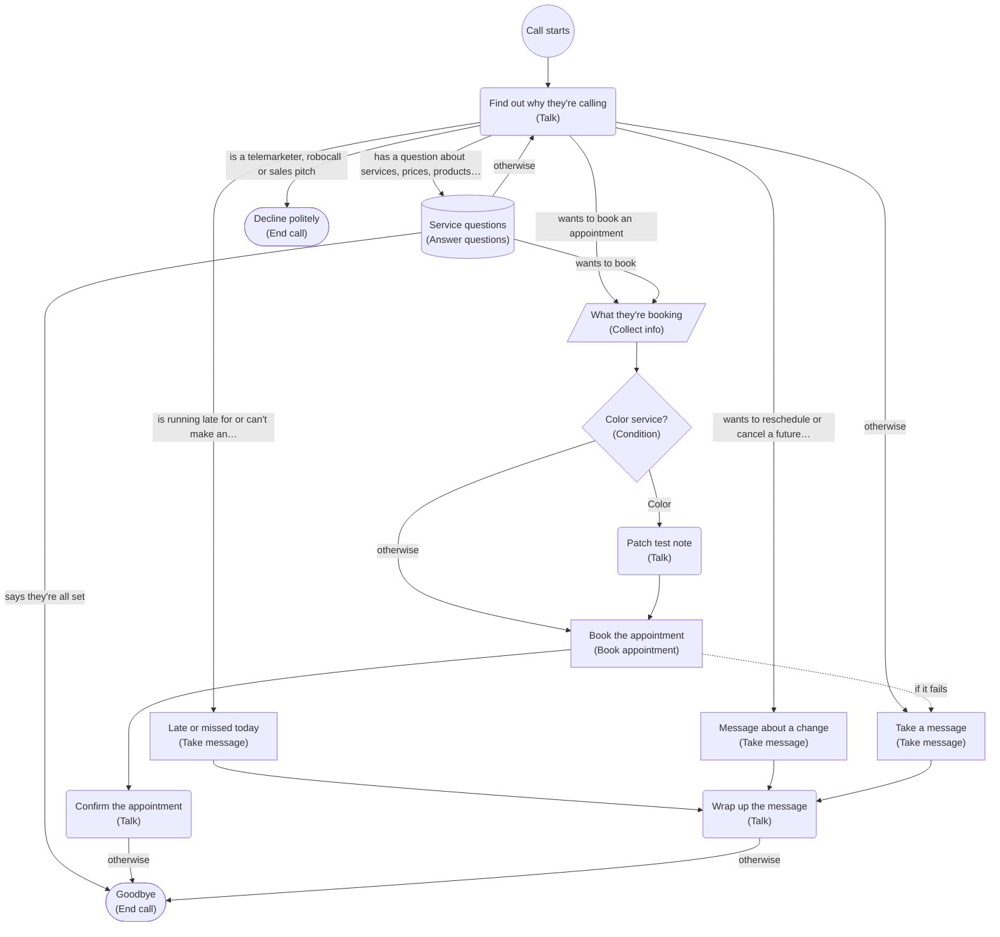

# Salon appointment booking

Books salon services with a preferred stylist and answers service and price questions from the knowledge base. Color clients hear about the patch test before they book.

## What it handles

- Bookings: service, preferred stylist and whether they're new, then two open times.
- Color and highlights: a one-sentence patch test note for new color clients before booking.
- Starting prices, how long services take and products, from the knowledge base.
- Running late, can't make it today, or changing a future appointment: a message for the front desk.

## Steps

<!-- BEGIN GENERATED: diagram (npm run diagram) -->
<!-- prettier-ignore-start -->

| Field | Type | Asked | What it's for |
| --- | --- | --- | --- |
| `service` | one of `haircut`, `color`, `highlights`, `blowout`, `extensions`, `treatment`, `nails`, `other` | Required | The service they want. |
| `stylist_preference` | string | Optional | A stylist they asked for by name, if any. |
| `new_client` | boolean | Optional | Whether they've been to the salon before. |

<!-- prettier-ignore-end -->
<!-- END GENERATED: diagram -->

## Before you publish

- Turn on **Book appointments** and **Look up open times** under **Tools** on the **Agent** tab, and connect a calendar.
- If each stylist has their own calendar, choose them all in the agent's **Calendars** card so the agent can offer a stylist's own times.
- Add a knowledge base with services, starting prices, durations and your patch test and cancellation policies.
- Make a test call for each path. See [Test your agent](https://tryladoo.com/docs/getting-started/test-your-agent).

## Import

Download [`workflow.lassi-workflow.json`](workflow.lassi-workflow.json), then in Ladoo open the agent's **Workflow** tab and choose **⋯ → Import from file**. To import through the API, see [Import into Ladoo](../../../README.md#import-into-ladoo).
